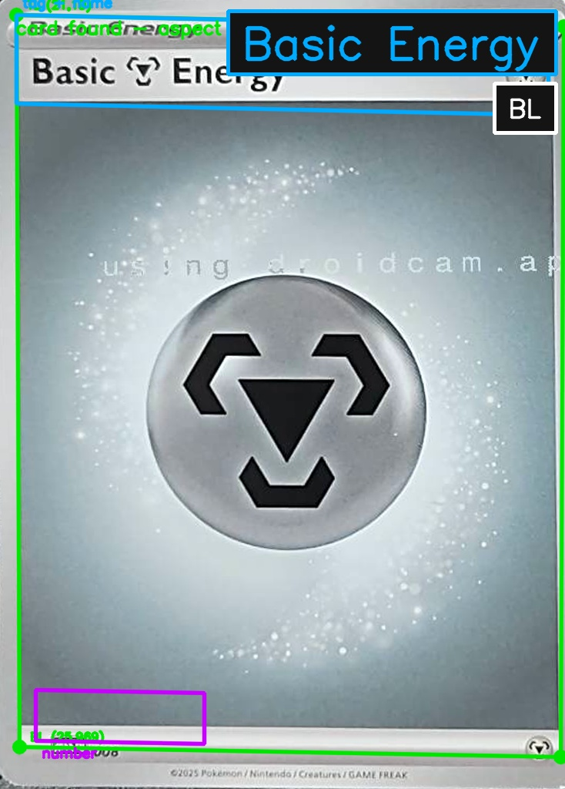
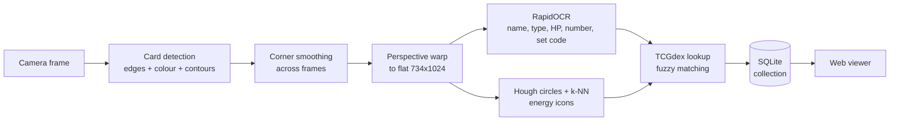

# Pokémon Card Reader

**Hold a Pokémon card up to a camera and it gets identified and added to your collection, with no manual typing.**

A real-time computer vision pipeline. It finds the card in a live video feed, corrects the perspective, reads the printed text with a deep-learning OCR model, classifies the energy symbols, matches everything against an online card database, and saves the result to a local SQLite collection you can browse in the browser.

<p align="center">
  
  <br><sub>Live output: the card's corners are detected (green), the type band and set badge are located and read, and the collector-number region is marked for OCR.</sub>
</p>

---

## Highlights

- **Classical CV card detection:** adaptive Canny edges, saturation and brightness segmentation, contour scoring by aspect ratio, rectangularity and corner skew. It works on pale cards on pale desks, sleeved cards and cluttered tables.
- **Perspective rectification:** a homography warps any tilted card into a flat, fixed-size 734×1024 image so every later stage reads from known regions.
- **Deep-learning OCR:** [RapidOCR](https://github.com/RapidAI/RapidOCR) (PaddleOCR's DBNet text detector and CRNN recogniser, run through ONNX Runtime) reads the card name, type, HP, collector number and set code.
- **Symbol classification:** energy icons are found with a Hough circle transform and classified by k-nearest-neighbour matching in CIELAB colour space against a reference set built from official card images, with leave-one-out evaluation built in.
- **Fuzzy entity resolution:** noisy OCR output is matched to the right printing among thousands through the [TCGdex API](https://tcgdex.dev), using fuzzy string scoring, OCR-error-aware number matching and set-code disambiguation.
- **Real-time engineering:** threaded frame capture, a background OCR worker, temporal corner smoothing and response caching keep the live view smooth while the heavy work runs off the UI thread.
- **Full stack:** SQLite persistence with schema migrations, plus a dependency-free web app for searching, filtering and sorting the collection.

## How it works



### 1. Finding the card (`card_border.py`)

Each frame is downscaled to 720px wide and turned into **three binary views**, because no single method works on every surface:

| View | Catches |
|---|---|
| **Auto-Canny edges**: thresholds taken from the 95th percentile of the Sobel gradient magnitude, not the usual brightness median | A card that barely contrasts with the table (a median-based Canny misses a pale card on light wood) |
| **Otsu on HSV saturation** | A printed card is far more colourful than wood, paper or a desk mat |
| **Otsu on brightness + morphological opening** | A pale card on a dark, textured playmat |

Every contour, plus its convex hull when artwork has carved into the outline, is fitted to a quadrilateral and **scored**. Candidates are rejected when they fail the real card's 63×88mm aspect ratio, when they are not rectangular enough, when their corners are more than 20° off square (this catches boxes seen in perspective) or when they run off the frame edge. One extra rule handles the artwork window, which is itself card-shaped: if the winner sits inside a larger card-shaped candidate, the larger one takes over.

A **`CornerSmoother`** blends each new detection into the last one with an exponential moving average to remove ~17px of frame-to-frame jitter. It snaps straight to a new position on large moves and holds the outline through brief dropouts.

### 2. Reading the text (OCR)

The flattened card is cut into known regions (type band, name, collector number, set badge), and each is enhanced before OCR. The order matters: first a **histogram stretch**, then **CLAHE**, then upscaling. A hazy webcam frame can have a pixel standard deviation under 10, and CLAHE on its own could not recover it.

The raw OCR output is then cleaned with rules learned from real misreads:
- `2O1/198`: the letter O read where a zero belongs
- `0917091`: the italic slash on older cards read as 7, 1 or l
- `#P120`, `MP120`: a mangled "HP", recovered by checking that the value is a plausible multiple of ten
- `CharizardeX`: the rule-box suffix glued onto the name

A second, **lower-confidence OCR pass** runs only as a fallback, for small italic text such as a basic energy's `008`, which reads at 47–59% confidence.

### 3. Classifying energy symbols (`energy_icons.py`)

Energy cards carry their type only as an icon. The reader:
1. finds candidate circles with a **Hough transform** in the top-right band,
2. cuts out a circular-masked 32×32 patch and converts it to **CIELAB**,
3. classifies it by **nearest-neighbour distance** to reference icons cut from official card art (`energy_icons.npz`), dropping circles that match nothing, such as digits and letters, unless the 3 nearest references agree.

The reference set can be rebuilt, extended with camera samples, and evaluated:

```bash
python energy_icons.py build <folder>          # build references from labelled cards
python energy_icons.py add Grass frame.png     # add a real camera sample
python energy_icons.py test <folder>           # leave-one-out accuracy
```

### 4. Identifying the exact printing (`card_search.py`)

The same Pokémon name exists in hundreds of printings, so the search combines several signals:
- exact-name variants queried **in parallel** (accent restoration `Pokemon → Pokémon`, `LV.X` handling, icon-in-name energies)
- the collector number, matched while **tolerating one-digit OCR errors**
- the set-code badge, matched by **fuzzy string similarity** against every known set code
- a wider "name contains" search when nothing exact fits
- special handling for anniversary and Play! Pokémon stamped reprints

API responses are cached on disk. One network fix made a big difference: card-image downloads waited about 16s for a dead IPv6 route before falling back to IPv4. Resolving IPv4 first cut that to about 0.15s.

### 5. The collection (`card_db.py`, `card_app.py`)

Identified cards go into **SQLite**. Scanning a duplicate raises its quantity instead of adding a row, and a stamped copy is tracked as its own entry. `card_app.py` serves a small single-page web app, built only on Python's standard library, with search, type and set filters, and sortable columns.

## Getting started

Requires Python 3.10+.

```bash
pip install -r requirements.txt

# Scan from a webcam (by index) or a phone camera stream (e.g. DroidCam)
python card_border.py --camera 0
python card_border.py --camera http://<phone-ip>:4747/video

# Run on a single photo (writes card_border_out.jpg)
python card_border.py --image my_card.jpg

# Browse the collection at http://localhost:8000
python card_app.py

# Look a card up directly
python card_search.py "Ultra Ball" 091/091
```

Press `q` or `Esc` to quit the live view. A 1080p stream is recommended, because at 720p the set-code badge is only about 25px wide and too small to read.

## Project structure

| File | Purpose |
|---|---|
| `card_border.py` | Live capture, card detection, rectification, OCR and the main loop |
| `energy_icons.py` | Energy symbol detection and k-NN classification |
| `energy_icons.npz` | Reference icon patches (the trained "model" data) |
| `card_search.py` | TCGdex / Limitless lookup, fuzzy matching, caching |
| `card_db.py` | SQLite collection storage and migrations |
| `card_app.py` | Web viewer for the collection |

## Tech stack

**Python** · **OpenCV** · **NumPy** · **RapidOCR / ONNX Runtime** (PaddleOCR models) · **SQLite** · **REST APIs** · **multithreading** · **HTML/CSS/JS**

## Skills demonstrated

- Computer vision: edge detection, segmentation, contour analysis, homography, Hough transforms, colour spaces, morphology
- Applied ML: deploying a pretrained deep OCR model, nearest-neighbour classification, building and evaluating a reference dataset
- Making noisy model output reliable with domain rules, fuzzy matching and confidence fallbacks
- Real-time systems: concurrency, latency profiling, temporal filtering
- Backend and data: API integration, caching, relational schema design, a lightweight web UI

---

*Card data from [TCGdex](https://tcgdex.dev) and [Limitless TCG](https://limitlesstcg.com). Pokémon and all related names are trademarks of Nintendo, Creatures Inc. and GAME FREAK. This is an unofficial fan project for learning purposes.*
